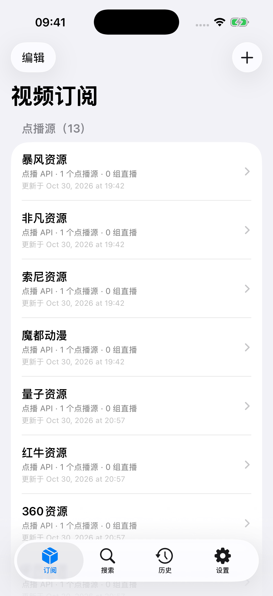
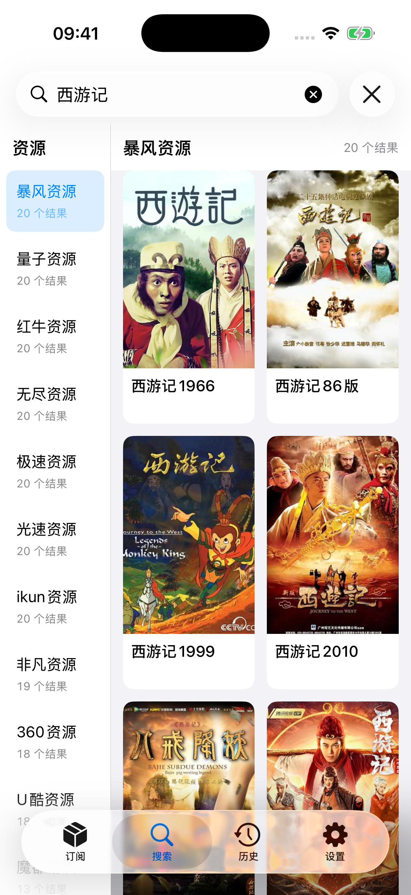
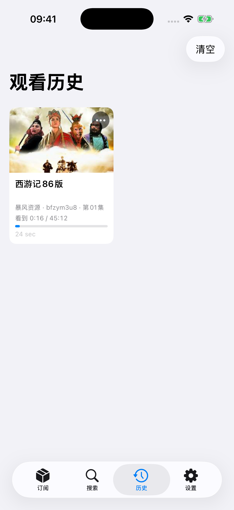
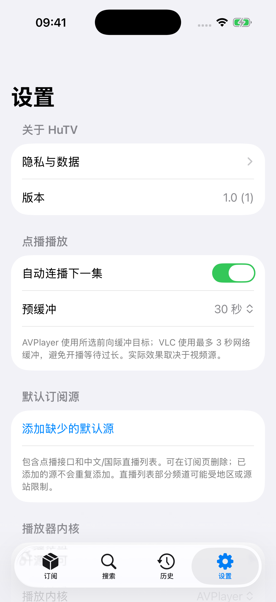

# HuTV

iPhone / iPad 原生视频订阅客户端，支持 CMS JSON 点播、M3U / TXT 直播及兼容的 TVBox 聚合配置，提供 AVPlayer 与 VLC 双播放内核。

## 功能

- **订阅管理**：点播、直播分组，支持单个或 JSON 批量导入，以及链接编辑、刷新、删除和拖动排序。
- **搜索浏览**：多源搜索，左侧资源按有效结果数量排序，右侧以封面卡片展示。
- **观看历史**：本机保存搜索历史、观看记录和进度，卡片式浏览并继续观看。
- **视频播放**：支持手势、暂停中央控制、倍速、剧集起播位置、自动连播、播放中换源，以及源和内核允许时的清晰度选择，默认自动。

详细操作和播放行为见[功能说明](Docs/Features.md)。

### 页面预览

| 订阅 | 搜索 | 历史 | 设置 |
|:---:|:---:|:---:|:---:|
| [](Docs/Images/subscriptions.png) | [](Docs/Images/search.png) | [](Docs/Images/history.png) | [](Docs/Images/settings.png) |


## 订阅

### 添加与管理

在订阅页点击右上角“+”，选择 **点播 API**、**直播 M3U / TXT** 或 **TVBox 配置**，填写地址和可选名称。也可选择“通过 JSON 批量导入”，从在线链接（含 GitHub 文件链接）、粘贴文本或本地文件读取多个订阅，预览勾选后导入；格式与示例见[批量导入说明](Docs/BatchSubscriptions.md)。

点击左上角“编辑”，可查看、复制、修改链接和名称，也可删除或在组内拖动排序。修改地址先验证，失败保留原配置；仅改名不联网。订阅页支持单项刷新和下拉刷新全部。自动刷新默认关闭，可在设置中开启并选择 1、6、12、24 小时间隔（开启后默认 6 小时），仅在 App 前台执行；在线 JSON 导入可保存链接并跟随列表变化，在“在线 JSON 列表”中管理，详细规则见[批量导入说明](Docs/BatchSubscriptions.md)。

点播优先使用 M3U8 / MP4 直链。支持 TVBox 配置中的兼容接口，不执行 Spider JAR、JS 爬虫或 `cms://` 插件，不提供通用网页解析和 DRM 绕过。公开收录地址不等于内容授权。

### 默认订阅源

默认配置包含下表的 13 个 CMS JSON 点播接口和 3 个直播列表。同类型、同地址的订阅不会重复添加；删除后不会自动恢复，可在设置页手动补充。

源站可用性、地区限制和测试范围见[资源验证记录](Docs/DefaultSources.md)。导入成功不代表全部内容都能播放。

#### 资源地址与来源

点播接口的 GitHub 收录参考 [cms-player/vod-source](https://github.com/cms-player/vod-source/blob/main/source.json)，360 接口另见 [fangkuia/XPTV](https://github.com/fangkuia/XPTV/blob/main/allinone.json)。这些是接口收录来源，不代表服务由 GitHub 或本 App 运营，也不代表已取得内容授权。

| 点播源 | CMS JSON 地址 | 收录来源 |
|---|---|---|
| 暴风资源 | `https://bfzyapi.com/api.php/provide/vod/` | — |
| 非凡资源 | `https://api.ffzyapi.com/api.php/provide/vod/` | — |
| 索尼资源 | `https://suoniapi.com/api.php/provide/vod/` | cms-player/vod-source |
| 魔都动漫 | `https://www.mdzyapi.com/api.php/provide/vod/` | — |
| 量子资源 | `https://cj.lziapi.com/api.php/provide/vod/` | cms-player/vod-source |
| 红牛资源 | `https://www.hongniuzy2.com/api.php/provide/vod/` | cms-player/vod-source |
| 360资源 | `https://360zy.com/api.php/provide/vod/` | fangkuia/XPTV |
| 无尽资源 | `https://api.wujinapi.com/api.php/provide/vod/` | cms-player/vod-source |
| 极速资源 | `https://jszyapi.com/api.php/provide/vod/` | cms-player/vod-source |
| 光速资源 | `https://api.guangsuapi.com/api.php/provide/vod/` | cms-player/vod-source |
| ikun资源 | `https://ikunzyapi.com/api.php/provide/vod/` | cms-player/vod-source |
| U酷资源 | `https://api.ukuapi.com/api.php/provide/vod/` | cms-player/vod-source |
| 闪电资源 | `https://sdzyapi.com/api.php/provide/vod/` | cms-player/vod-source |

| 直播列表 | M3U 地址 | 来源项目 |
|---|---|---|
| IPTV-org 中文 | `https://iptv-org.github.io/iptv/languages/zho.m3u` | [iptv-org/iptv](https://github.com/iptv-org/iptv) |
| Free-TV 国际 | `https://raw.githubusercontent.com/Free-TV/IPTV/master/playlist.m3u8` | [Free-TV/IPTV](https://github.com/Free-TV/IPTV) |
| IPTV-org 新闻 | `https://iptv-org.github.io/iptv/categories/news.m3u` | [iptv-org/iptv](https://github.com/iptv-org/iptv) |

## 开发

### 架构与依赖

订阅、内容接口和播放状态由 Core 管理，Features 提供 SwiftUI 页面。直播与点播共用播放器页面和控制逻辑，下层支持 AVPlayer / MobileVLCKit。模块职责、依赖版本和许可见[架构与播放器依赖](Docs/Architecture.md)。

### 构建与测试

需要 Xcode、XcodeGen 和 iOS 模拟器运行时，最低系统为 iOS / iPadOS 17。

```sh
./scripts/fetch-vlckit.sh
xcodegen generate
```

打开 `HuTV.xcodeproj`，选择 `HuTV` Scheme。真机安装需配置自己的签名团队和 Bundle ID。

```sh
xcodebuild -project HuTV.xcodeproj -scheme HuTV \
  -destination 'platform=iOS Simulator,name=iPhone 17 Pro' test
```

工程由 XcodeGen 生成；构建产物、用户配置、凭据和 VLC 二进制不入库。依赖下载脚本包含 SHA-256 校验，开源许可随 App 打包。依赖和目录说明见[架构文档](Docs/Architecture.md)。

### 签名与发布

在 [GitHub Releases](https://github.com/xiahouzuoxin/HuTV/releases) 下载未签名 IPA 和 SHA-256 校验文件，再使用自己的 Apple ID 通过 Sideloadly 签名安装。

供 Sideloadly 重新签名的真机 IPA，在 Mac 上执行：

```sh
./scripts/package-ipa.sh
```

脚本构建 Release、将 VLC 等可执行文件精简为 arm64、移除旧签名并校验，统一输出 `output/HuTV.ipa`。覆盖现有 App 时可用 `HUTV_BUNDLE_ID=已有包标识 ./scripts/package-ipa.sh` 指定 Bundle ID，并沿用 Sideloadly 中的签名账号与最终应用标识。

首次安装或更新时将该 IPA 导入 Sideloadly，开启自动刷新。日常续签使用其缓存，无需重新打包；更新本地 IPA 后必须重新导入安装，缓存才会更新。主窗口可以关闭，菜单栏 / 托盘后台程序需保持运行；支持 USB 或配置好的同局域网 Wi-Fi 连接。

- [Mac / Windows 签名续期](Docs/SigningRefresh.md)
- [发布准备清单](Docs/Release/Checklist.md)

隐私说明随 App 打包，可在“设置 → 隐私与数据”查看。发布前需核实默认源的内容授权，并完成相应审核要求。
